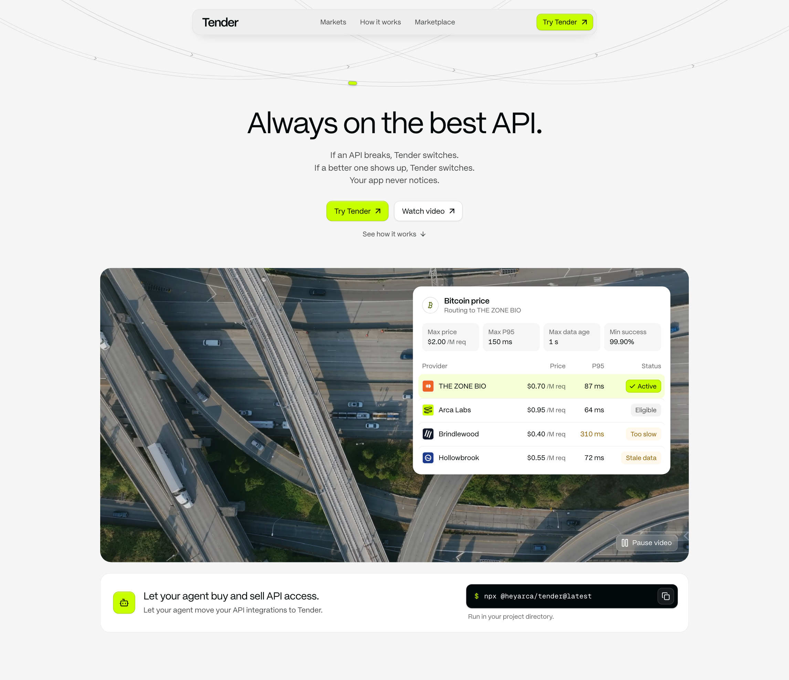

# Tender

[](https://tender.heyarca.app)

**Always on the best API.** Tender is a marketplace where API providers bid to serve each request on
price, latency, data freshness, and reliability. You declare what you need; Tender routes every request
to the best provider that meets it, and switches the moment a provider stops qualifying. Your app never
notices.

**Live:** https://tender.heyarca.app · **Markets:** https://tender.heyarca.app/markets ·
**Demo:** https://tender.heyarca.app/demo

## Let your agent use Tender

```bash
npx @heyarca/tender@latest
```

Adds Tender instructions to your project's `AGENTS.md` / `CLAUDE.md`, so coding agents route API calls
through Tender instead of hard-coding a provider. The same package is a small CLI
(`markets`, `categories`, `contracts`, `market <id>`, `quote <id>`) and a zero-dependency client. See
[`packages/tender`](packages/tender/README.md).

## What's in Tender

- **75 markets in 7 groups.** Each market implements one of 37 typed contracts, so switching providers
  never changes your code:
  - **Weather & environment:** Weather, Air quality
  - **Market data:** Electronic components, Commodities, Stock quotes, Currencies, Crypto prices
  - **Travel & logistics:** Flight status, Freight rates, Parcel tracking, Traffic & travel time, Geocoding
  - **AI models:** LLM chat, Embeddings, Speech to text, Text to speech, Image generation, Translation, OCR & documents
  - **Identity & risk:** IP intelligence, Email & phone verification, Sanctions & KYC, Company data
  - **Web data:** Web search & scraping
  - **Sports & events:** Sports scores
- **Routing policy.** Max price per request, max P95 latency, max data age, min success rate, and a
  preference (lowest cost, lowest latency, freshest data), with automatic switching or a pinned provider.
- **Live provider competition.** Bids, performance history, qualification status, and the routing
  decision for every market, with immediate failover and a short cooldown for better offers.
- **Pay per request in USDC.** Contract endpoints answer `402 Payment Required` with the winning
  provider's price and payee; a signed retry settles USDC on Base Sepolia through x402.

Provider names in the market data are fictional, except Arca Labs and THE ZONE BIO
([`docs/provider-logos.md`](docs/provider-logos.md)).

## How Tender uses PayPal

Tender's PayPal edition moves the money on both sides of the marketplace through PayPal: buyers fund
prepaid Tender credits, and providers get paid for the requests they serve. Per-request micropayments
don't fit card rails, so requests are metered against a credit balance, like other API marketplaces.
Status of each flow:

| Flow | PayPal API | Status |
|---|---|---|
| Buyers add funds to their Tender credits | Checkout: JS SDK v6, Orders v2 create and capture | Live |
| Credits are added once, when PayPal confirms the capture | Webhooks: `PAYMENT.CAPTURE.COMPLETED`, signature verification | Live |
| Each successful request deducts the winning bid from the balance | Tender ledger (integer micro-USD) | Live |
| Agents spend only within a weekly limit you approve | Tender ledger | Live |
| Ask Tender tops up by itself from a saved PayPal account, never more than the weekly limit; without one it asks you to approve each top-up | Vault v3 payment tokens, merchant-initiated Orders v2, approve link | Live |
| Providers receive their earnings | Payouts (batch payouts), payout webhooks | Live |
| Ask Tender looks up orders, sends invoices, and lists transactions | PayPal Agent Toolkit | Live (transaction listing starts working once PayPal enables transaction search on the app) |

Everything runs on the PayPal sandbox with test accounts, so no real money moves. Testing credentials for
a sandbox buyer are in the submission's testing instructions.

Credentials go in `PAYPAL_CLIENT_ID`, `PAYPAL_CLIENT_SECRET`, and `PAYPAL_WEBHOOK_ID` (see
[`.env.example`](.env.example)). The plan: [`docs/PAYPAL-HACKATHON.md`](docs/PAYPAL-HACKATHON.md).

## How Tender uses AI

In the product:

| Feature | How AI is used | Status |
|---|---|---|
| `npx @heyarca/tender` | Writes instructions and MCP configs that make coding agents call APIs through Tender | Live |
| Ask Tender | A chat agent (Vercel AI SDK, `openai/gpt-5-mini` through the Vercel AI Gateway) finds a market, sets the routing policy, asks you to approve a weekly spending limit, tops up from your saved PayPal within that limit, runs paid requests with credits, and reports spend. | Live |
| Provider bidding agents | An LLM reprices each provider's bid from its wins, rival bids, and performance, between 70% and 150% of its listed bid, and explains each change in the activity log | Live |

Building Tender: the code was written with AI coding agents. Prime Agent orchestrated parallel workers
running Claude Opus 5.5 (product UI and engine) and GLM-5.3-Flash (backend audits and fixes).

## How Tender uses AG Grid

Every table in Tender is [AG Grid](https://www.ag-grid.com/react-data-grid/) Community 36 (no Enterprise
modules, no licence key) behind one wrapper, [`src/components/ui/data-grid.tsx`](src/components/ui/data-grid.tsx):

- **Tender theme with the Theming API.** `themeQuartz.withParams(...)` maps the design tokens (PP Mori,
  hairline borders, olive focus, lime only as a fill) onto cells, headers, inputs, floating filters,
  editors, checkboxes, tooltips, and pinned rows; `withPart` adds lucide sort and filter icons. No AG Grid
  CSS file is imported.
- **Features per grid.** A grid lists what it uses (`features={["quickFilter", "editing", ...]}`) and gets
  exactly those Community modules, so AG Grid validates each grid's setup.
- **Loaded when needed.** AG Grid ships as its own chunk that loads when a grid comes within a screen of the
  viewport, with the grid's height reserved so nothing jumps. The landing page shows grids far below the
  fold, so it no longer downloads AG Grid up front (first-load JS on `/landing`: 749 KB gzip before this
  work, 514 KB after).

| Grid | Where | AG Grid features | Why |
|---|---|---|---|
| Market directory | `/markets`, Table view | Quick filter (search box), external filter (group tabs and category sidebar), Number Filters with custom React floating filters (≤ bid, ≤ P95, ≥ success), column state, row ids with immutable updates and cell flashing, React cell renderers (P95 trend), pinned column on small screens, CSV export | 75 markets tick every 5 s from the monitor; one query (search, filters, sort) is shared with the list view and mirrored in the URL, so a filtered, sorted view is a link |
| Providers | Every market page | Row ids and row animation, custom comparators, full-width divider row, `flashCells` on route switches, row selection | The ranking re-orders live as bids and conditions change |
| Provider conditions | Every market page | Inline editing with number and checkbox editors, `readOnlyEdit` + `cellEditRequest` into the store, undo/redo (⌘Z, ⌘⇧Z), cell class rules for edited values, React tooltip component with every policy check | Edit any provider like a spreadsheet; routing re-evaluates on Enter and the providers grid re-ranks |
| Bid history | Every market page, Bidding agents | `applyTransaction({ add, addIndex: 0 })`, flashing new rows, Text Filter by provider, tooltips, row virtualisation past six rows | Each agent round and each manual edit slides in at the top without re-rendering the log |
| Provider leaderboard | `/leaderboard` | Quick filter, Number Filters in floating filters, pinned totals row that follows the filters, live flashing, CSV export | All 29 providers across the 75 markets: markets won right now, bids, measured P95 and success, and PayPal earnings |
| Transactions | `/account` | Text Filters (type, who paid) and a Date Filter with relative ranges, set from Tender selects; three pinned totals rows (top-ups, charges, net) that follow the filters; CSV export | Reconcile PayPal top-ups against what requests and Ask Tender spent |
| Earnings and payout batches | `/payouts` | Sortable columns, pinned totals row, expandable batch rows, CSV export | What Tender owes each provider and what PayPal Payouts sent |

## HTTP API

| Method | Path | |
|---|---|---|
| GET | `/api/v1/markets` | Every market with its group, category, contract, contract URL, and default policy |
| GET | `/api/v1/markets/{id}` | Provider bids, performance, and the routing decision for a policy |
| GET | `/api/v1/categories` | Groups and categories with market counts |
| GET | `/api/v1/contracts` | Contracts (the API shapes markets implement) with output schemas |
| GET | `/api/v1/{namespace}/{action}?…` | Paid call to a contract (x402), for example `/api/v1/weather/current?location=seoul` or `/api/v1/translation/text?source=en&target=ko` |
| GET | `/api/v1/openapi.json` | OpenAPI 3.1 |

Details: [`docs/API.md`](docs/API.md) and [`docs/PAYMENTS.md`](docs/PAYMENTS.md).

## Develop

Requires [Bun](https://bun.sh) 1.x (Node.js 18+ for `npx`).

```bash
bun install
bun run dev                  # http://localhost:3000
```

The site runs without any environment variables. For paid requests from the console:

```bash
cp .env.example .env.local
bun run payments:wallets     # creates the testnet payer wallet in .env.local and prints its address
```

Fund that address with Base Sepolia USDC at https://faucet.circle.com. Other payment tools:

- `bun run payments:balances`: payer and payee USDC balances on Base Sepolia.
- `bun run payments:smoke <url> [market]`: one real paid request against a running deployment, for
  example `bun run payments:smoke http://localhost:3000 sf-weather`.
- `bun scripts/payments/inspect.ts <txHash>`: the USDC transfers in a settlement transaction.

Before you push:

```bash
bun run typecheck
bun run build
```

Next.js 16 (App Router), React 19, TypeScript, Tailwind CSS v4.

- Product spec: [`docs/SPEC.md`](docs/SPEC.md)
- Design system: [`docs/DESIGN.md`](docs/DESIGN.md)
- Data model: [`docs/DATA-MODEL.md`](docs/DATA-MODEL.md)
- Engine: [`src/lib/tender/README.md`](src/lib/tender/README.md)

## Deploy

Tender runs on Vercel. Every push to `main` deploys to production; other branches get preview URLs.

1. Import the repository in Vercel. It detects Next.js and Bun; the build command is `bun run build`.
2. Add the environment variables you use from [`.env.example`](.env.example) under Project Settings →
   Environment Variables. Paid console requests need `TENDER_DEMO_PAYER_PRIVATE_KEY`.
3. Set the production branch to `main`.

From the CLI: `vercel link`, then `vercel env add TENDER_DEMO_PAYER_PRIVATE_KEY`, then `vercel --prod`.

## License

[MIT](LICENSE). Built by [Arca Labs](https://heyarca.app).
